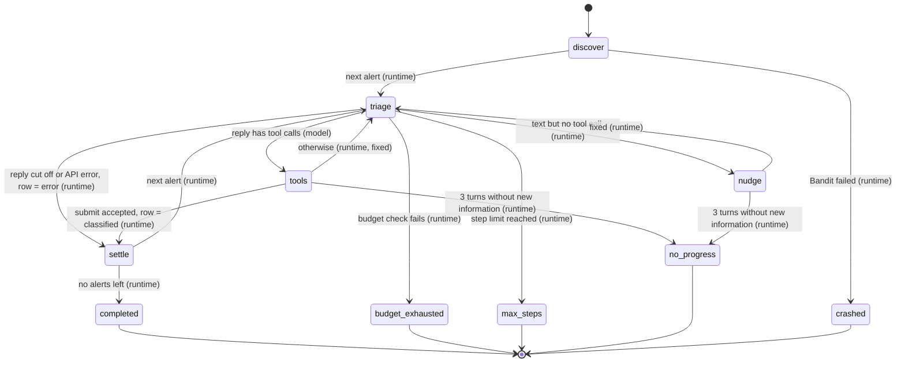
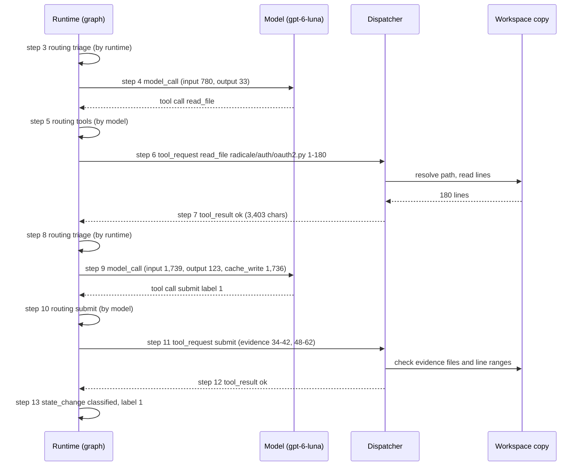

# HW1 Report: Bounded Agent for Bandit Alert Classification

Agent: `vulnagent` (Python 3.12, OpenAI `gpt-6-luna` through the Responses API). The final
runs are in `runs/<target>-<budget>/` and the development runs in `runs/dev/`.

## A1. Behaviours

The agent handles the alerts one at a time, in report order. When an alert starts, the
runtime first hides every other OWASP `BenchmarkTest*` file so that only the case under
investigation is visible (on Radicale and SGLang there is nothing to hide at this point).
Then it opens a new conversation with the system prompt and one user message built from
Bandit's own output: rule id, severity, confidence, file, line, Bandit's message and the
flagged code snippet.

From there the model reads code with `read_file`, `search` and `list_dir`. In most traces
it reads the flagged function first and then follows the data back to where it comes from,
for example a request cookie, a config value or a constant. The alert ends when the model
calls `submit` with a label (1 or 0), a short rationale that cites line numbers, and 1 to 5
evidence ranges. The runtime checks the submit, writes one report row and one
`state_change` for the alert, puts the hidden files back and moves on to the next alert.

The agent must never run target code, write to the target or invent observations. None of
the tools can execute anything, they only read text files, and Bandit, the only external
program, parses the code without importing it. The tools also cannot write to the real
target, because the agent works on a copy of `--input` in a temp folder, and Bandit writes
its JSON to a temp folder too.

To stop invented observations, only the dispatcher creates `function_call_output` items,
and only after it has actually run a tool. Text the model writes stays in the conversation
as the model's own message and is never turned into a tool result. The prompt also says
"Never describe code you have not read", and `submit` refuses evidence that points to a
file that does not exist in the copy (a hidden sibling case counts as not existing) or to
lines past the end of the file.

## A2. State machine

## A3. Nodes and edges

The graph has five nodes:

| Node | What it does |
|---|---|
| discover | Runs Bandit over the `[scan]` scope and parses the alerts |
| triage | Checks `max_steps`, then the budget, then makes one model call and writes `model_call` |
| tools | Sends each tool request to the dispatcher in order; `submit` is checked here too |
| nudge | Appends a user message asking the model to call a tool or submit |
| settle | Writes the alert's one `state_change` and its report row |

Each edge writes a `routing` event, and its `by` field says who made the decision:

| From → to | Conditional or fixed | Decided by | `decision` |
|---|---|---|---|
| start of an alert → triage | fixed | runtime | `triage` |
| triage → tools | conditional | model (it chose to call tools) | `tools`, or `submit` if the calls include submit |
| triage → nudge | conditional | runtime (no tool call in the reply) | `nudge` |
| triage → settle (error) | conditional | runtime (reply cut off at the output allowance, or API error) | `error` |
| tools → triage | fixed | runtime | `triage` |
| tools → settle (classified) | conditional | runtime (submit passed validation) | none; the `state_change` with `node = "submit"` records it |
| triage → stop | conditional | runtime | `budget_exhausted` or `max_steps` |
| tools / nudge → stop | conditional | runtime | `no_progress` |

## A4. Agent state

| Field | Lifetime | Written by | Reducer | Model sees it? |
|---|---|---|---|---|
| `alerts` | run | discover | set once | only the current alert, through the first user message |
| `rows` | run | settle | insert once per `alert_id`; a second insert raises an error | no |
| `steps` | run | triage, tools | +1 per model call and per tool execution | no |
| token ledger (`Trace._usage_total`) | run | `Trace.model_call` | sum of each counter | no |
| `budget.exhausted` | run | budget check | False → True only (sticky) | no |
| `items` (conversation) | alert | triage (model output), tools (tool outputs), nudge | append only | yes, this is everything the model sees |
| `seen_calls` | alert | tools | set union | no |
| `stalled` | alert | tools, nudge | reset to 0 on progress, else +1 | no |
| `counted_tokens`, `counted_items` | alert | triage | replaced after each model call | no |
| hidden sibling files | alert | `Workspace.investigating` | moved out at start, moved back at end | no |

`counted_tokens` is the last call's input + output as the provider reported it, and
`counted_items` is how long `items` was at that point. The budget check uses them (see A6).
I made the conversation append only because the trace has to match what the model
actually saw. If the runtime changed old messages, the two would not line up anymore.
Every alert gets a new `AlertState`, so nothing from one alert's conversation is carried
into the next one.

## A5. Tools

All model tools go through the dispatcher. It parses the
arguments as JSON, checks that the tool exists, validates the arguments against the tool's
JSON Schema (the same schema I send to the model), runs the tool, and writes the
`tool_request` / `tool_result` pair. Any problem goes back to the model as an observation
starting with `REFUSED:` instead of crashing the run. If a tool raises something I did not
expect (a bug), the dispatcher still writes `tool_result` with `ok: false` before letting
the error go up. Every path argument goes through `Workspace.resolve`, which refuses
absolute paths, any path containing `..`, and any path that ends up outside the copy after
following symlinks. Bandit is not a model tool: the runtime runs it once in `discover`
and records it as a `tool_request` / `tool_result` pair with `alert_id: null`.

`read_file(path, start_line=1, end_line=None)` returns the requested lines with line
numbers and a header such as `radicale/auth/oauth2.py, lines 1-180 of 180`. It returns at
most 200 lines per call and cuts each line at 300 characters. If the range is longer, it
returns the first 200 lines and tells the model which line to continue from. It refuses a
path outside the copy, a missing file (hidden sibling cases count as missing), a file that
is not UTF-8 text, `start_line < 1`, `end_line < start_line`, a `start_line` past the end
of the file, and unknown, extra or wrongly typed arguments.

`search(pattern, path=".")` runs a Python regex over the text files under `path` and
returns one `path:line: text` line per match. It stops at 50 matches and tells the model to
narrow the search, skips files over 1 MB and files that are not UTF-8, and cuts lines at
300 characters. Each file it finds while walking the tree also goes through `resolve`, so
a symlink that points outside the copy is skipped. It refuses an invalid regex, a path
outside the copy and a path that does not exist.

`list_dir(path=".")` lists a directory, with `/` after subdirectories, up to 200 entries.
It refuses a path outside the copy and a path that is not a directory.

`submit(label, rationale, evidence)` takes `label` 0 or 1, a `rationale` of 1 to 2000
characters, and 1 to 5 `evidence` objects with `path`, `start_line` and `end_line`. It
refuses anything that does not match the schema, an evidence file that does not exist in
the copy, and a line range outside the file. A refused submit goes back to the model so it
can try again. An accepted submit settles the alert as `classified`, and a leading `./` in
evidence paths is removed before the row is written.

## A6. Start, stop and termination

A run starts with `vulnagent --input <checkout> --output <dir> --config <toml>`. The CLI
loads the TOML and validates it against `config.schema.json`, so an invalid config stops
before anything is written. Then it creates the output folder, copies the config into it
as `config.toml`, opens `trace.jsonl`, creates the model client and the agent, runs Bandit,
copies the target into a temp folder and goes through the alerts in report order.

Exactly one `terminal` event is written, as the last line. Its status is one of these:

| Status | Trigger | Rows that are not classified yet get |
|---|---|---|
| `completed` | every alert was settled normally (classified, or error for that alert only) | nothing left |
| `budget_exhausted` | a budget check before a model call failed | `budget_exhausted`, label null |
| `max_steps` | `steps >= max_steps` before a model call | `error`, rationale says the run stopped |
| `no_progress` | one alert had 3 turns in a row without new information | `error`, rationale says the run stopped |
| `crashed` | an exception escaped, including a Bandit failure or Ctrl+C | `error`, rationale has the exception |

Only one of them can happen because the run stops at the first one. The budget,
`max_steps` and `no_progress` each raise `RunStopped` with their own status and `run()`
returns it. `crashed` is the starting value of `status` in `cli.main` and only gets
replaced when `run()` returns. By "a turn without new information" I mean a model turn
where every tool call was refused or was an exact repeat of an earlier call for the same
alert (I compare the tool name plus the arguments with sorted keys), or where the model
only wrote text. When a reply is cut off, or an API call still fails after the SDK's own
retries, only that alert becomes an `error` row and the run goes on with the next one.

For crashes, `cli.main` uses `try / except / finally`. The `except` block gives an `error`
row (with its `state_change`) to every alert that does not have a row yet, and the
`finally` block writes the terminal event and `report.json`. I create the agent object
before running Bandit, so if copying the workspace fails, every alert Bandit found still
gets a row. `report.json` is first written to a `.tmp` file and then renamed, so a crash in
the middle of writing cannot leave half a file. My tests cover both a crash on the third
model call and a failed Bandit run.

The budget charge is `input + output` exactly as the provider reports them in `usage`,
summed over every `model_call`. `cache_read` and `cache_write` are recorded but not
charged. The running sum is kept in one place, the trace's ledger, and both the budget
check and `used_tokens` in `report.json` read it from there. A failed API call has no
usage, so nothing is charged and no `model_call` is written. The output allowance is sent
on every call as `max_output_tokens`. For a reasoning model this limit includes the
reasoning tokens, and if a reply gets cut off by it the alert becomes `error`.

The budget is checked in `triage` right before every model call, after the `max_steps`
check. The check computes `required = estimated input + output_allowance` and skips the
call if `required` is more than `max_tokens - used`. For the first call of an alert the
estimate is `len(json.dumps(items + tools)) / 3 + 50`. For later calls I take the
provider's count for the previous call (input + output) and only estimate the tool outputs
added since, with `len(json.dumps(new items)) / 3 + 50`. Dividing by 3 instead of the usual
4 characters per token keeps the estimate on the high side. When the check fails, the
runtime writes a `routing` event with `remaining` and `required`, and every alert without a
row, including the current one, gets `budget_exhausted`. After one failed check no more
model calls are made in that run. In the final `radicale-low` run the cutoff happened in
the fourth alert, and the `routing` event shows `remaining = 11725` and
`required = 13146`.

## A7. Workspace and withholding

The model only ever sees a copy of `--input` that `shutil.copytree` makes in a temp folder
(`Workspace.__enter__`). The copy is deleted when the run ends, also after a crash. These
are the files the agent is not allowed to see:

| Hidden | Targets | Why | How |
|---|---|---|---|
| `.git/` (at any depth) | all | the history can contain commits after the pinned one, including fixes | not copied |
| `expectedresults*.csv` | OWASP | it is the answer key | not copied |
| top-level `results/` | OWASP | it holds other scanners' output (Bandit SARIF, Bearer JSON) for every case, with code snippets from the sibling cases | not copied |
| every other `BenchmarkTest*` file | OWASP | each case has a safe twin; comparing the two gives the answer away | moved out of the copy while one alert is investigated |

I left `data/` and the `templates/web/*-Index.html` pages visible because they only list case
names and URLs, not labels or code. `helpers/` is visible too, since following a value into
`helpers/` is a normal part of investigating an alert.

For the per-alert hiding, `Workspace.investigating(alert_path)` takes the stem of the
alert's file (for example `BenchmarkTest00011`) and moves every `BenchmarkTest*` file with a
different stem into a `withheld/` folder next to the copy. The case keeps its own `.py` and
`.html`. On OWASP this moves 2,458 of the 2,460 files. The `withheld/` folder is outside the
copy's root, so `resolve` refuses any path into it. Radicale and SGLang have no
`BenchmarkTest*` files, so nothing is moved there and the same code works on all three
targets.

The per-alert move is undone in a `finally` block when the alert is settled, even if it
ended with an exception, so the next alert can see its own file. The run-level hiding does
not need to be undone, because the original `--input` is never changed and the copy is
deleted at the end.

My tests check that `.git`, the answer key and `results/` are not in the copy, that `..`, absolute paths and a symlink to `/etc` are
refused, that only the case's two files are visible during an alert, that `search` cannot
find code that only exists in the sibling file, and that the files come back after the
alert, also after a simulated crash.

## C2. Results

The final runs use `configs/full.toml` and `configs/low.toml` with each target's `[scan]`
block swapped in, and each run folder also has the `config.toml` it used. The settings are `gpt-6-luna`, prompt v2,
`reasoning_effort = "low"`, `output_allowance = 4000`, `max_steps = 500`, and `max_tokens`
800,000 for full and 60,000 for low.

| Run | Terminal status | Tokens used | Label 1 | Label 0 | null |
|---|---|---|---|---|---|
| radicale-full | completed | 217,408 | 6 | 4 | 0 |
| radicale-low | budget_exhausted | 48,275 | 2 | 1 | 7 |
| sglang-full | completed | 388,281 | 16 | 5 | 0 |
| sglang-low | budget_exhausted | 54,854 | 2 | 0 | 19 |
| owasp-full | completed | 95,257 | 8 | 10 | 0 |
| owasp-low | budget_exhausted | 55,878 | 3 | 9 | 6 |
### OWASP precision and recall

I scored the OWASP runs against `expectedresults-0.1.csv` (18
alerts, 8 of them real vulnerabilities in the key). The final run `runs/owasp-full` got
TP 7, FP 1, TN 9, FN 1, which is precision 0.88, recall 0.88 and accuracy 0.89. The two
mistakes were BenchmarkTest00017 B317, where the model agreed that external entities are
off by default but still said 1 because internal entity expansion is not blocked, and
BenchmarkTest00058 B324, which I explain below.

I ran OWASP several times while tuning and read the rationale of every wrong row:

| Run | Change | TP | FP | TN | FN | Precision | Recall |
|---|---|---|---|---|---|---|---|
| owasp-full-prompt-v1 | first prompt, low | 8 | 3 | 7 | 0 | 0.73 | 1.00 |
| owasp-full-prompt-v2 | two more prompt bullets, low | 7 | 3 | 7 | 1 | 0.70 | 0.88 |
| owasp-full (final) | same as v2 | 7 | 1 | 9 | 1 | 0.88 | 0.88 |

In v1 the false positives were BenchmarkTest00017 (B317 and B318) and BenchmarkTest00075
(B102). For 00017 the model said the XML parser was open to XXE, but `xml.sax` in Python
3.12 does not resolve external entities by default. For 00075 the code only runs `exec`
on a value that starts and ends with `'` and has no `'` inside, which can only be a plain
string literal, but the model called the check "superficial". I did not want to put these
answers into the prompt, because that would only help on OWASP. So I added two general
bullets instead (prompt v2): judge a function by how it behaves by default in Python 3.12,
and work out whether any input that passes a validation check can still cause harm. v2
fixed B318 for 00017 but not B317 or 00075, and it got two new mistakes (00058 and 00073)
whose rationales had nothing to do with the new bullets. With 18 alerts and a model that
does not give the same answer twice, one run is not enough to tell whether a prompt change
helped. I kept v2 for the final runs because both bullets are true in general and also
apply to Radicale and SGLang. The final run has exactly the same setup as v2 and made 2
mistakes instead of 4.

BenchmarkTest00058 (B324) was wrong in both v2 and the final run. The model found that the
value being hashed comes from a hard-coded config entry (`a_Value`) and that the cookie is
stored under a different key, so user input never reaches SHA-1. The answer key marks every
MD5 or SHA-1 use in this category as a vulnerability no matter what is hashed. I did not
change the prompt to match the key here, because on Radicale the model judged a SHA-1 alert
the same way (SHA-1 only used to compare two event dicts, so label 0), and that is the
answer I would want on a real project. I also noticed that the key labels the test case's
category, not Bandit's rule. BenchmarkTest00013 to 00016 are XPath injection cases
(`xpathi`, all false), but Bandit flags them for B314 (XML parsing), so the key and the
alert are not always talking about the same problem.

### Trajectory of one alert

This diagram is drawn from `runs/radicale-full/trace.jsonl`, steps 3 to 13, alert
`radicale-auth-oauth2-py-60-B113` (a `requests` call without a timeout).

The model read the whole file once, saw that `requests.post` to the configurable OAuth2
endpoint has no timeout, and submitted with two evidence ranges. This alert cost 2,675
tokens. It is one of the short ones; most Radicale alerts took 4 to 7 model calls.

## C3. Limitations and alternatives

Almost all of the cost is input. In `radicale-full`, 214,005 of the 217,408 tokens were
input, because every model call sends the whole conversation again and each tool result
stays in it until the alert ends. Alerts are also handled one at a time in separate
conversations, so similar alerts can get different labels. In `radicale-full` the four
`pickle.load` calls in `radicale/sharing/files.py` got 1, 1, 1 and 0, and the model never
saw what it had said about the other three.

Some limits come from my own design choices. `no_progress` stops the whole run and not just
the stuck alert, so one stuck alert gives `error` to all the alerts after it. `max_steps` is only checked before model calls, so one
reply with several tool calls can go a few steps over the limit before the run stops. The
budget estimate for new tool output (characters / 3) is still a guess even though it is on
the high side. And `submit` only checks that the evidence lines exist, not that the model
actually read them.

I compared my design with three other architectures:

| | My design (one tool loop per alert) | Fixed workflow | Plan-and-execute | Supervisor / worker |
|---|---|---|---|---|
| How it works | the model picks the next tool after each result, until it submits | the runtime always reads a fixed window around the flagged line, then one model call gives the label | a planner call lists the files and searches to do, the runtime runs them, a final call gives the label | a supervisor hands alerts (or groups of alerts) to several workers that each run a loop like mine |
| Cost | about 22k tokens per alert on Radicale, 4 to 7 calls, mostly re-sent input | one call per alert with a few thousand input tokens, much cheaper | about 2 or 3 calls per alert; tool results are not re-sent after every step | workers cost about the same as mine, plus supervisor calls |
| Latency | sequential; 110 s for Radicale, 248 s for SGLang | lowest, and alerts can run in parallel easily | fewer model round trips; planned reads can run in parallel | lowest wall time, since workers run in parallel |
| Coordination | none between alerts; the budget and step counter are simple counters | none | the plan has to match what the code really looks like; if the first reads show something new, it needs a replan step | the hardest: the token budget and step counter are shared, so each check needs a lock, and the trace needs one writer to keep `step` going up by 1 |
| Failure behaviour | can loop or wander, which is why I need `max_steps` and `no_progress`; can follow data into other files | cannot loop, but cannot follow data into other files either, so cross-file alerts (the storage hook in `radicale/storage/multifilesystem/lock.py`, which depends on `config.py`) would often be wrong | a bad plan wastes reads, and the plan is made before the model has seen the code | one worker failing does not stop the others; grouping alerts from the same file to one worker would fix the inconsistent `pickle.load` labels |

A fixed workflow would probably be good enough for OWASP, where each case is one short file
(in the final `owasp-full` run the median alert took 2 model calls and about 3,100 tokens),
and it would be much cheaper. It would do worse on Radicale and SGLang, where the answer
often depends on another file. If I built a second version, I would take one idea from
supervisor/worker and group alerts by file, so that one conversation sees all the related
call sites.

## Contributions

This was a solo submission. I did the design, the code and tests, all the runs, and this
report.
